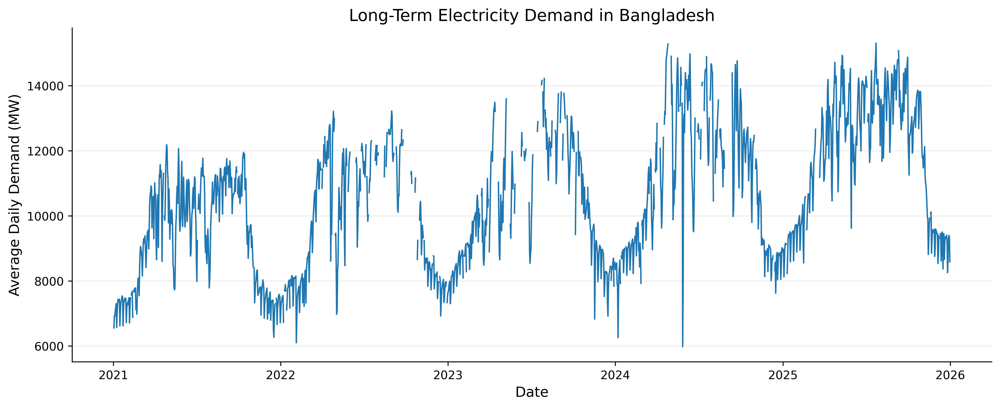
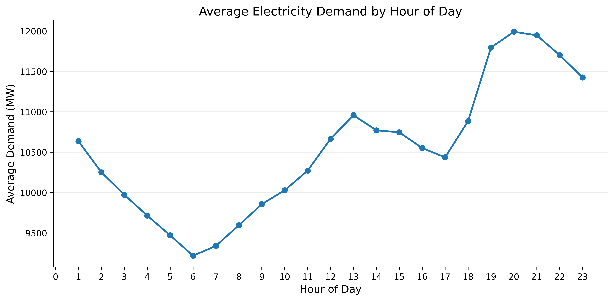
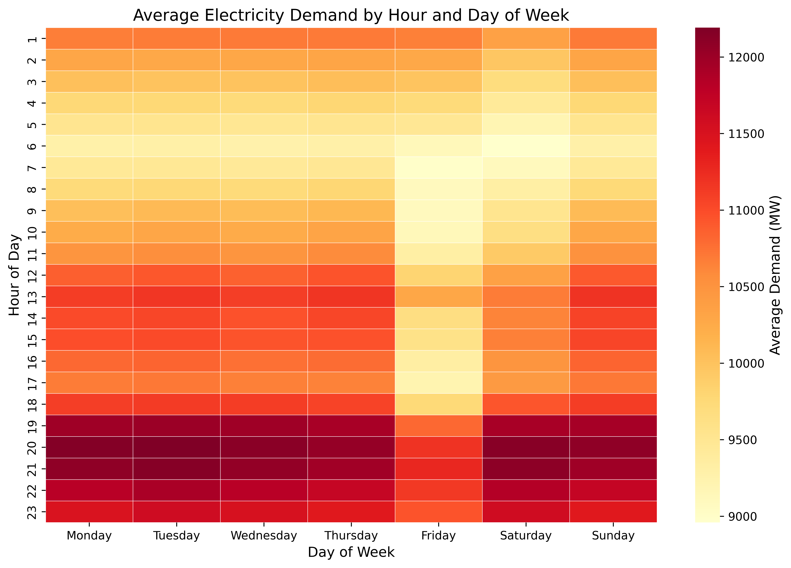
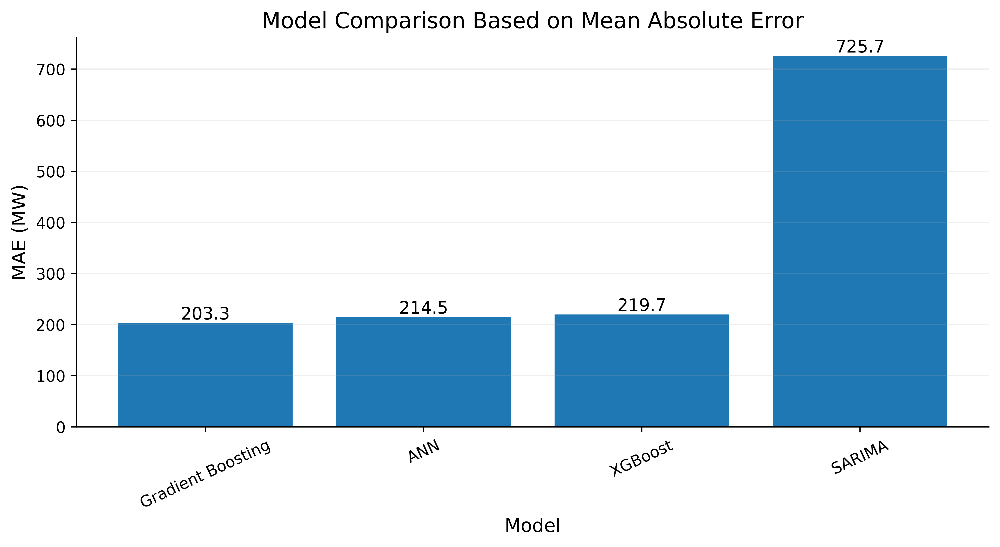
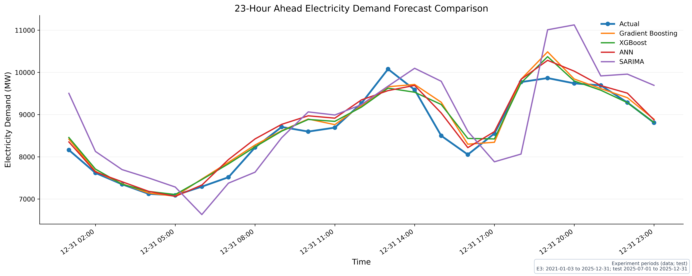
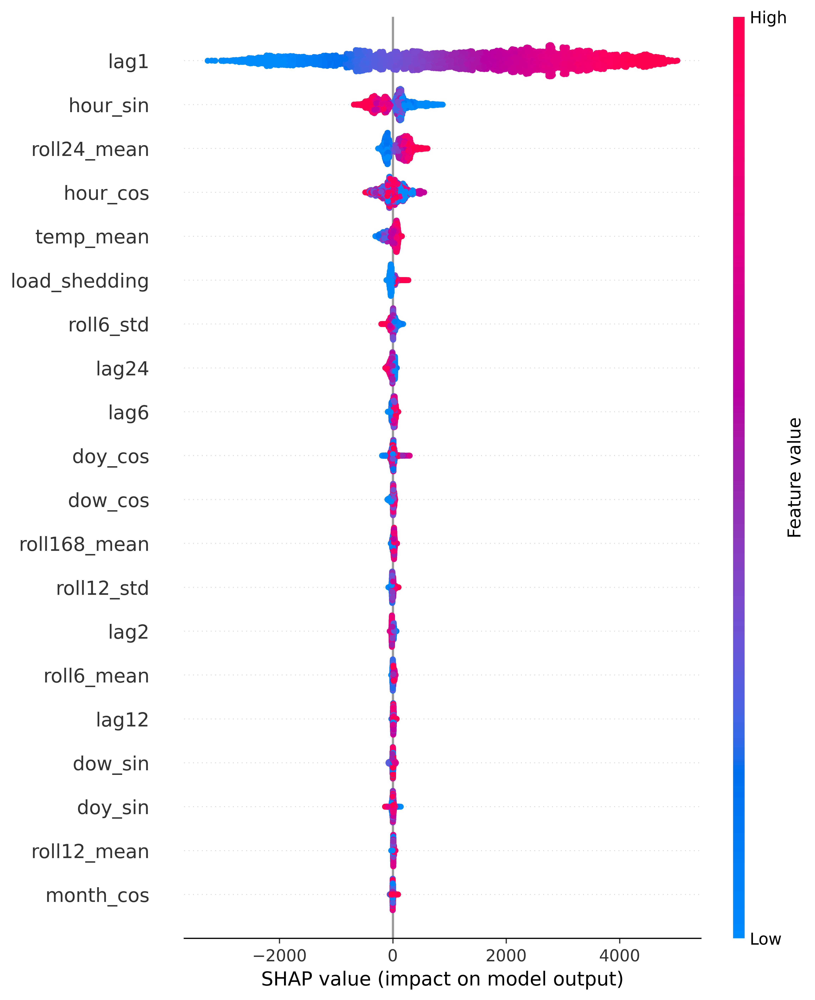

# Bangladesh Electricity Demand Forecasting

An hourly electricity-demand forecasting study combining national demand and
load-shedding records with aggregated weather observations. The project covers
data preparation, exploratory analysis, time-ordered model tuning, comparative
evaluation, saved model artifacts, and an optional Streamlit forecasting
interface.

## Project workflow

The notebooks are intended to be read and run in this order:

1. [`EDA.ipynb`](EDA.ipynb) documents the source data, joins demand with
   division-level weather, creates nationwide weather averages, and exports
   prepared datasets and exploratory figures.
2. [`Hyperparameter_tuning_of_models.ipynb`](Hyperparameter_tuning_of_models.ipynb)
   compares three AutoARIMA configurations and uses Optuna to search
   Gradient Boosting and XGBoost configurations.
3. [`final_model.ipynb`](final_model.ipynb) engineers the model features,
   evaluates four forecasting approaches in three chronological experiments,
   writes comparison results and figures, and trains full-history models for
   reuse.
4. [`Publication-quality.ipynb`](Publication-quality.ipynb) prepares
   publication-ready exports from the analysis outputs.

The high-level data and model flow is in [`project_diagram.md`](project_diagram.md);
the step-by-step run order and important checks are in [`WORKFLOW.md`](WORKFLOW.md).

## Data

The prepared input [`cleaned_combined_data.csv`](cleaned_combined_data.csv)
contains 42,611 rows spanning 2020-01-01 03:00 through 2025-12-31 23:00.
The modeling input [`cleaned_min_hours_23.csv`](cleaned_min_hours_23.csv)
contains 36,547 rows spanning 2021-01-02 01:00 through 2025-12-31 23:00. It
retains days meeting the notebook's minimum 23-observations-per-day criterion.
After lag construction removes initial rows, the final notebook reports 36,524
modeling samples.

| Column | Role | Meaning |
|---|---|---|
| `datetime` | Time index | Timestamp of the observation |
| `demand_mw` | Target | National electricity demand in MW |
| `load_shedding` | Analysis variable | Load-shedding value, used for stress analysis rather than as one of the six model inputs |
| `temp_mean` | Model input | Mean temperature across the included regional weather series |
| `wspd_mean` | Model input | Mean wind speed across the included regional weather series |

Weather is merged across the six regional files loaded by the EDA notebook.
The notebook applies a complete-case filter to the merged weather table before
calculating regional means and joining weather to demand. The source inputs
(`pgcb_V1_raw.csv` and the regional hourly weather CSVs) are stored outside
this project folder and are not included here.

## Features and target

The models forecast `demand_mw` from six predictors:

| Feature | Definition |
|---|---|
| `hour_sin`, `hour_cos` | Cyclic encoding of the hour of day |
| `temp_mean`, `wspd_mean` | Aggregated weather inputs |
| `lag1` | Demand from the previous row |
| `lag23` | Demand from 23 rows earlier |

Lag offsets are row-based. Because the prepared table can contain missing
hourly timestamps, `lag23` should not automatically be interpreted as exactly
23 elapsed clock hours. The notebook uses `load_shedding` to distinguish
stress and normal test observations, but it is not included in the six-feature
model matrix.

## Models and evaluation

The final notebook compares:

- Gradient Boosting regression
- XGBoost regression
- A residual artificial neural network (ANN)
- StatsForecast AutoARIMA with weather and demand-lag regressors (reported as
  SARIMA). Cyclic hour regressors are excluded from this model after causing
  numerically unstable full-history fits.

Evaluation uses three cumulative datasets with chronological six-month test
windows. Training data ends before each test period; observations are not
randomly shuffled across the time boundary.

| Experiment | Evaluation period | Lowest saved MAE | MAE (MW) | RMSE (MW) | R² |
|---|---|---|---:|---:|---:|
| 1 (2021-2023 data) | 2023-07-01 to 2023-12-31 | ANN | 175.64 | 306.48 | 0.9801 |
| 2 (2021-2024 data) | 2024-07-01 to 2024-12-31 | Gradient Boosting | 182.29 | 265.74 | 0.9853 |
| 3 (2021-2025 data) | 2025-07-01 to 2025-12-31 | ANN | 172.11 | 243.01 | 0.9880 |

These values are the saved experiment results in
[`model_results_top.csv`](model_results_top.csv). They are period-specific
holdout results, not a guarantee of future performance. The ranking can differ
between periods. MAE, RMSE, and MAPE are error measures (lower is better); R²
is the coefficient of determination, not classification accuracy. See
[`model_hyperparameters.csv`](model_hyperparameters.csv) for the final model
configurations and the distinction between tuning and final-fit settings.

## Selected figures

The figures below provide a visual overview of the demand patterns, evaluation
results, and model interpretation. Each image is an exported analysis artifact
from [`paper_figures/`](paper_figures/); it is not generated dynamically when
this README is viewed.

### Demand patterns



*Long-term demand varies across the study period, with both sustained changes
in level and substantial short-term fluctuations. This overview motivates
time-aware evaluation rather than a random train/test split.*



*The hourly average shows a recurring daily demand profile, including lower
average demand in the morning and higher demand in the evening. The curve is a
historical average, not a forecast for a specific day.*



*This heatmap combines hour-of-day and day-of-week patterns. It helps reveal
when demand tends to be higher or lower across the week; cell colors represent
average demand in MW.*

### Model evaluation and interpretation



*The chart summarizes saved MAE values (MW) across the available model and
experiment records. The evaluation windows differ by experiment, so read each
bar together with its experiment label rather than treating this as a
single-period head-to-head ranking.*



*An example from Experiment 3 compares observed demand with four model
forecasts over a 23-hour window. It illustrates how predictions track the
observed profile in this particular interval; it does not replace the
full-period metrics in `model_results_top.csv`.*



*The SHAP summary shows how feature values influenced individual Gradient
Boosting predictions in the analyzed sample. Points to the right or left of
zero increase or decrease a prediction relative to the model baseline;
color indicates relative feature value. These are model associations, not
causal effects.*

## Tuning and final-fit settings

The tuning notebook tests three AutoARIMA search sizes on its final
six-calendar-month split. Its lowest recorded RMSE is 234.456988 for
`season_length=23`, `max_p=4`, `max_q=4`, `max_P=2`, `max_Q=2`, and
`max_order=6`. Because those configurations are compared on the same holdout,
this selection RMSE is not an independent final performance estimate. The
notebook also defines 100-trial Optuna searches for XGBoost and Gradient
Boosting using a time-ordered validation tail.

The final notebook specifies fixed configurations for its evaluated models
and separately trains full-history artifacts. Do not assume that a parameter
written in the final notebook is the best Optuna trial. The tuning notebook
currently reads `cleaned_min_hours_23.csv` through a hard-coded path under
`5_model`; update that path to the dataset in this folder before rerunning it.

## Saved outputs

- `model_results_top.csv` — ranked regression metrics by experiment and model.
- `model_hyperparameters.csv` — final-fit configurations and tuning notes.
- `paper_figures/` — EDA, comparison, forecast, residual, and interpretation
  figures.
- `saved_models/` — fitted model and preprocessing artifacts, ordered feature
  names, hourly fallback demand values, and model metadata.

The optional [`streamlit_app.py`](streamlit_app.py) loads saved artifacts for
interactive inference; it does not retrain the models. See
[`STREAMLIT_GUIDE.md`](STREAMLIT_GUIDE.md) for launch instructions, inputs,
and known inference limitations.

## Running the project

Use an environment with the packages in [`requirements.txt`](requirements.txt).
From this directory, run the notebooks in workflow order with Jupyter. Several
notebook cells contain machine-specific absolute paths, including paths to
source CSVs outside this directory; update those paths to your local data
locations before rerunning the notebooks. The notebooks also write outputs to
their current working directory, so run them with this folder as the working
directory when you want generated files to land here.

To launch the optional interface from this directory:

```bash
python -m streamlit run streamlit_app.py
```

The page and controls are in [`streamlit_app.py`](streamlit_app.py); model
loading and forecast calculations are in [`forecast_engine.py`](forecast_engine.py).

## Limitations and interpretation

- The EDA source-data description names more weather stations than the six
  regional CSVs actually loaded by its code. The prepared weather averages are
  computed from the loaded regional files.
- Days with at least 23 records do not by themselves guarantee a perfectly
  regular hourly series. Check timestamp gaps before interpreting row lags or
  hourly forecast horizons.
- Model scores vary across the three evaluation periods; report the period
  alongside any score.
- The ANN and tree-based estimators use the fitted scaler and feature order
  saved under `saved_models/`. Regenerate them together if the feature
  definitions change.
- Weather and load-shedding values used for a future forecast must be known or
  forecast for the target time. Historical observations unavailable at
  forecast time can cause leakage if used as future predictors.
- Saved artifacts and notebook outputs reflect a particular run, data state,
  and package environment. Re-run and record versions when reproducing results.
