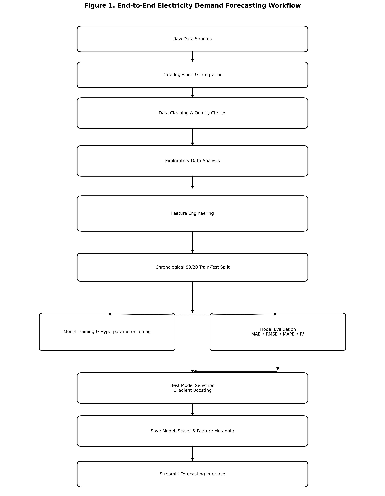
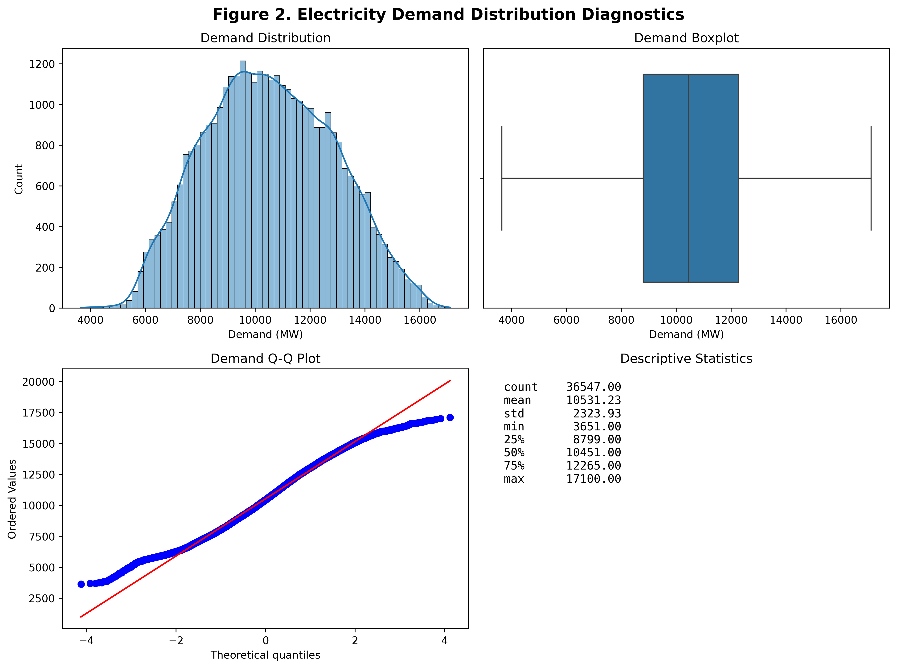
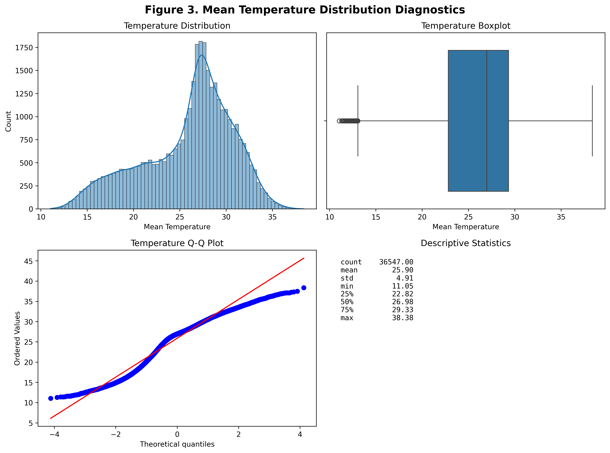
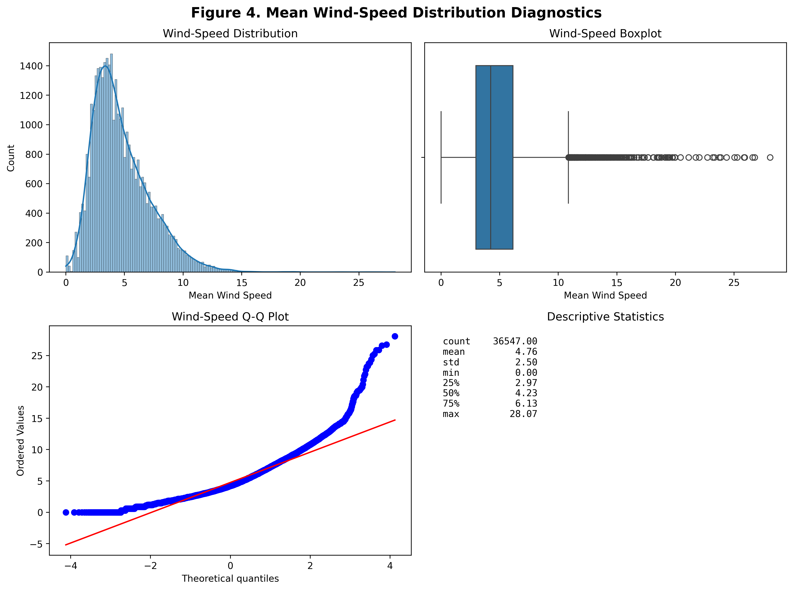
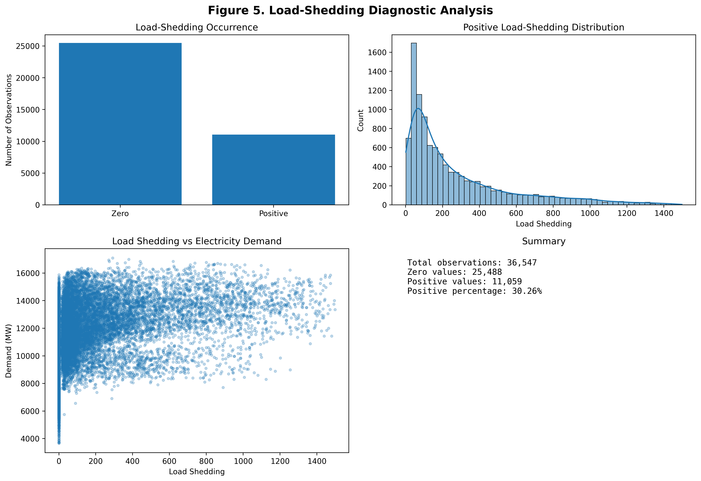
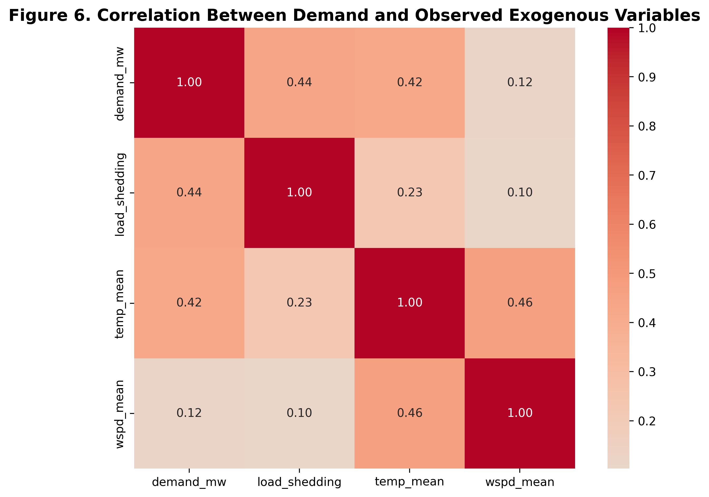
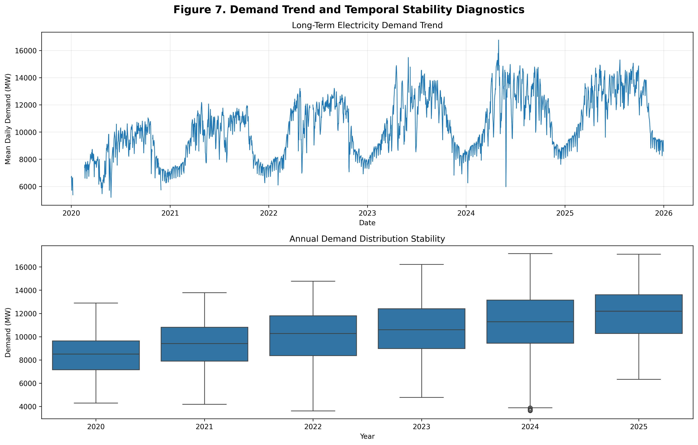

# Bangladesh Electricity Demand Forecasting

A time-aware forecasting project that combines historical electricity demand, weather observations, temporal features, and classical/statistical and machine-learning models. The repository includes exploratory analysis, hyperparameter-tuning notebooks, saved model artifacts, evaluation figures, and a Streamlit prediction interface.

## Project at a glance

- **Target:** `demand_mw` (electricity demand in MW)
- **Model inputs:** numeric load-shedding values, mean temperature, mean wind speed, temporal encodings, demand lags, and rolling statistics
- **Prepared dataset:** 42,611 observations from 2020-01-01 through 2025-12-31
- **Validation:** chronological 80/20 train-test split with shuffling disabled
- **Best saved regression model:** Gradient Boosting, MAE 203.3 MW, RMSE 271.9 MW, and R² 0.985

## End-to-end workflow

**Figure 1.** High-level view of the data-to-forecast workflow. The PNG is rendered at 320 DPI; the SVG is the scalable vector version.



[Open the vector SVG](paper_figures/Fig1_workflow.svg)

[Open the complete workflow flowchart](WORKFLOW.md) for the notebook-level data preparation, feature engineering, model tuning and evaluation, generated artifacts, and the implemented Streamlit prediction path.

## Data and feature engineering

The modelling table is [`cleaned_combined_data.csv`](cleaned_combined_data.csv), with the timestamp, target, and observed exogenous variables:

| Field | Role | Description |
|---|---|---|
| `datetime` | Index | Observation timestamp |
| `demand_mw` | Target | Electricity demand in megawatts |
| `load_shedding` | Exogenous | Numeric load-shedding observation; source units/semantics are not specified in the prepared CSV |
| `temp_mean` | Exogenous | Mean temperature |
| `wspd_mean` | Exogenous | Mean wind speed |

The persisted Gradient Boosting model uses 31 predictors. Calendar features are represented cyclically so that adjacent periods (for example, hours 23 and 0) remain close in feature space.

| Feature group | Model features |
|---|---|
| Cyclic calendar (8) | `hour_sin`, `hour_cos`, `dow_sin`, `dow_cos`, `month_sin`, `month_cos`, `doy_sin`, `doy_cos` |
| Observed drivers (3) | `load_shedding`, `temp_mean`, `wspd_mean` |
| Demand lags (10) | `lag1`, `lag2`, `lag3`, `lag6`, `lag12`, `lag24`, `lag48`, `lag72`, `lag168`, `lag336` |
| Rolling statistics (10) | `roll6_mean`, `roll6_std`, `roll12_mean`, `roll12_std`, `roll24_mean`, `roll24_std`, `roll48_mean`, `roll48_std`, `roll168_mean`, `roll168_std` |

Lag and rolling features use prior demand history. Rows without the required history are excluded before model fitting. The model metadata records 33,820 training samples, a 0.2 test fraction, and `shuffle=false`.

## Models and evaluation

The training and tuning notebooks cover four forecasting approaches:

| Model | Approach |
|---|---|
| Gradient Boosting | Tree-based regression; persisted model and feature metadata are included |
| XGBoost | Gradient-boosted decision trees |
| ANN | Artificial neural network |
| AutoARIMA / SARIMA | Statistical time-series forecasting |

The following scores are recorded in [`model_results_top.csv`](model_results_top.csv). Models are ordered by MAE (lower is better); R² is reported as a coefficient of determination, not classification accuracy.

| Model | MAE (MW) ↓ | RMSE (MW) ↓ | MAPE (%) ↓ | R² ↑ |
|---|---:|---:|---:|---:|
| **Gradient Boosting** | **203.3** | **271.9** | **1.745** | **0.9850** |
| XGBoost | 219.7 | 287.5 | 1.866 | 0.9832 |
| ANN | 222.7 | 298.0 | 1.860 | 0.9820 |
| SARIMA | 325.9 | 393.8 | 3.809 | 0.8293 |

These are the saved evaluation results in the repository; retraining can produce different values depending on data and library versions. Hyperparameter search spaces and selected settings are documented in [`Hyperparameter_tuning_of_models.ipynb`](Hyperparameter_tuning_of_models.ipynb), and the saved Gradient Boosting configuration is in [`saved_models/model_metadata.json`](saved_models/model_metadata.json).

## Diagnostic figures

Figures 2–7 were generated from the cleaned dataset and saved as 320-DPI PNGs with companion SVGs. Continuous-variable diagnostics include histograms, density estimates, boxplots, Q–Q references, and descriptive statistics. The `load_shedding` column is numeric, not a binary flag: 13,834 of 42,611 rows have a positive value. Figure 5 therefore visualizes zero vs. positive values and the positive-value distribution; the original source does not define its units in the prepared CSV.

| Figure | Diagnostic | Image |
|---|---|---|
| **Figure 2** | Demand distribution, spread, and normality reference | <br>[SVG](paper_figures/Fig2_demand_distribution.svg) |
| **Figure 3** | Mean temperature distribution diagnostics | <br>[SVG](paper_figures/Fig3_temperature_distribution.svg) |
| **Figure 4** | Mean wind-speed distribution diagnostics | <br>[SVG](paper_figures/Fig4_wind_speed_distribution.svg) |
| **Figure 5** | Numeric load-shedding values: zero/positive counts, positive-value distribution, and relationship with demand | <br>[SVG](paper_figures/Fig5_load_shedding_diagnostics.svg) |
| **Figure 6** | Correlation between observed target and exogenous variables | <br>[SVG](paper_figures/Fig6_feature_correlation_diagnostics.svg) |
| **Figure 7** | Demand trend and annual distribution stability | <br>[SVG](paper_figures/Fig7_temporal_stability_diagnostics.svg) |

## Forecast and model-analysis figures

The repository also contains these previously exported analysis assets. Their filenames retain their original notebook numbering, independent of README Figures 1–7 above.

| Original asset label | Description | Asset |
|---|---|---|
| 1 | Long-term demand history | [PNG](paper_figures/Fig1_long_term_demand.png) |
| 2 | Hourly demand profile | [PNG](paper_figures/Fig2_hourly_demand_profile.png) |
| 3 | Hour-by-day demand heatmap | [PNG](paper_figures/Fig3_hour_day_heatmap.png) |
| 4 | Monthly demand profile | [PNG](paper_figures/Fig4_monthly_demand.png) |
| 5 | Temperature-demand relationship | [PNG](paper_figures/Fig5_temperature_demand.png) |
| 6 | Correlation heatmap | [PNG](paper_figures/Fig6_correlation_heatmap.png) |
| 7A–7C | MAE, RMSE, and R² model comparisons | [MAE](paper_figures/Fig7A_MAE_comparison.png) · [RMSE](paper_figures/Fig7B_RMSE_comparison.png) · [R²](paper_figures/Fig7C_R2_comparison.png) |
| 8 | Actual vs. predicted demand over 24 hours | [PNG](paper_figures/Fig8_actual_vs_predicted_24h.png) |
| 9 | SARIMA forecast with prediction interval | [PNG](paper_figures/Fig9_SARIMA_prediction_interval.png) |
| 10 | Gradient Boosting residuals over time | [PNG](paper_figures/Fig10_residuals.png) |
| 11 | Gradient Boosting residual distribution | [PNG](paper_figures/Fig11_residual_distribution.png) |
| 12 | Global SHAP feature importance | [PNG](paper_figures/Fig12_SHAP_global.png) |
| — | Annual average demand | [PNG](paper_figures/yearly_average_demand.png) |

## Repository layout

```text
4_model/
├── README.md
├── EDA.ipynb
├── Hyperparameter_tuning_of_models.ipynb
├── final_model.ipynb
├── cleaned_combined_data.csv
├── merged_all_divisions_weather_data.csv
├── model_results_top.csv
├── model_accuracy_bar_plot.png
├── paper_figures/               # EDA, workflow, forecast, and model figures
├── saved_models/                # Model files, scaler, and feature metadata
├── streamlit_app.py
└── STREAMLIT_GUIDE.md
```

## Run the project

Use Python with the packages imported by the notebooks and dashboard (`numpy`, `pandas`, `scikit-learn`, `xgboost`, `torch`, `statsforecast`, `matplotlib`, `seaborn`, `scipy`, `streamlit`, and Jupyter).

```bash
python -m pip install numpy pandas scikit-learn xgboost torch statsforecast matplotlib seaborn scipy streamlit jupyter
jupyter lab
```

Open `EDA.ipynb` for data preparation and exploratory analysis, `Hyperparameter_tuning_of_models.ipynb` for search experiments, or `final_model.ipynb` for model fitting and evaluation. The notebooks currently contain machine-specific file paths in some cells; update those paths to the local project location before running them on another machine.

To launch the Streamlit interface from this directory:

```bash
streamlit run streamlit_app.py
```

The current dashboard loads the saved Gradient Boosting model, scaler, and feature metadata from `saved_models/`. See [`STREAMLIT_GUIDE.md`](STREAMLIT_GUIDE.md) for interface details.

## Limitations and reproducibility

- A chronological split better reflects forecasting than random shuffling, but it is a single holdout evaluation; rolling-origin backtesting is recommended before operational deployment.
- The model depends on historical demand for its lag and rolling features. Forecast generation requires a correctly aligned recent demand history.
- The prepared `load_shedding` values are numeric and frequently zero. Their units and operational definition should be verified against the source data before interpreting feature effects or using the feature in production.
- The notebooks include local absolute paths, and the repository currently does not include a `requirements.txt`; package versions should be pinned when reproducing or deploying the pipeline.
- Reported scores describe the saved experiment and should not be interpreted as a guarantee of future forecast performance.

## Contact

- **Author:** Mahfuzur Rahman
- **Email:** mahfuzurrahman8747@gmail.com
- **GitHub:** [@mahfuzurrahman8747](https://github.com/mahfuzurrahman8747)
