# Complete Electricity Demand Forecasting Workflow

This flowchart follows the files currently in `4_model/`: data preparation and
exploration, feature engineering, model tuning and evaluation, saved artifacts,
publication outputs, and the implemented Streamlit prediction path.

```mermaid
flowchart TD
    subgraph INPUTS["1. Source data"]
        DEMAND["Electricity demand CSV<br/>datetime, demand_mw, load_shedding"]
        WEATHER["Hourly weather CSVs<br/>six regional datasets"]
        CLEAN_IN["cleaned_combined_data.csv<br/>42,611 observations · 2020–2025"]
        DEMAND --> EDA
        WEATHER --> EDA
        CLEAN_IN --> EDA_NOTEBOOK
    end

    subgraph PREP["2. Preparation and exploration — EDA.ipynb"]
        EDA["Read and inspect demand and weather sources"]
        EDA --> ALIGN["Rename regional weather columns<br/>outer-join by timestamp"]
        ALIGN --> CLEAN_WEATHER["Drop incomplete weather timestamps"]
        CLEAN_WEATHER --> MERGED_OUT["Write merged_all_divisions_weather_data.csv"]
        CLEAN_WEATHER --> AVERAGE["Average regional temperature and wind"]
        AVERAGE --> JOIN["Inner-join weather with demand<br/>and load-shedding by datetime"]
        JOIN --> CHECK["Inspect missing values, distributions,<br/>outliers, correlations, and trends"]
        CHECK --> PREP_OUTPUTS["Write cleaned_combined_data.csv"]
        EDA_NOTEBOOK["Reload prepared dataset<br/>for feature engineering and plots"]
    end

    PREP_OUTPUTS --> FEATURES
    PREP_OUTPUTS --> EDA_NOTEBOOK
    EDA_NOTEBOOK --> FEATURES
    EDA_NOTEBOOK --> EDA_FIGS["EDA figures<br/>demand, weather, load shedding,<br/>correlations, temporal stability"]

    subgraph MODELING["3. Time-series features, training, and evaluation"]
        FEATURES["Sort by datetime; derive calendar fields"]
        FEATURES --> ENCODE["Cyclic calendar encodings<br/>hour, day-of-week, month, day-of-year"]
        ENCODE --> HISTORY["Demand history features<br/>lags: 1, 2, 3, 6, 12, 24, 48, 72, 168, 336<br/>rolling mean/std: 6, 12, 24, 48, 168"]
        HISTORY --> DROP["Drop rows missing lag / rolling history"]
        DROP --> SPLIT["Chronological 80/20 train-test split<br/>shuffle disabled"]
        SPLIT --> SCALE["Fit StandardScaler on training features<br/>transform train and test"]
        SCALE --> TUNE["Hyperparameter_tuning_of_models.ipynb<br/>AutoARIMA search; Optuna tuning<br/>for Gradient Boosting and XGBoost"]
        SCALE --> TRAIN["final_model.ipynb<br/>fit Gradient Boosting, XGBoost,<br/>ANN, and AutoARIMA / SARIMA"]
        TUNE --> TRAIN
        TRAIN --> EVALUATE["Evaluate held-out predictions<br/>MAE, RMSE, MAPE, R²"]
        EVALUATE --> RESULTS["Sort and save model_results_top.csv<br/>generate model comparison plots"]
        RESULTS --> SELECT{"Select best evaluated model"}
        SELECT -->|Lowest MAE in saved results| BEST["Gradient Boosting<br/>MAE 203.3 · RMSE 271.9 · R² 0.985"]
    end

    subgraph OUTPUTS["4. Model, analysis, and publication artifacts"]
        BEST --> SAVE["saved_models/<br/>M_GBoosting.pkl · M_X_scaler.pkl<br/>feature_name.json · model_metadata.json"]
        TRAIN --> OTHER["Other saved model artifacts<br/>M_XGBoost.pkl / .json · M_ANN.pth · M_SF.pkl"]
        EVALUATE --> DIAGNOSTICS["Forecast and diagnostic figures<br/>actual vs. predicted, SARIMA interval,<br/>residuals, SHAP, and model comparisons"]
        PREP_OUTPUTS --> PUBLICATION["Publication-quality.ipynb<br/>exports paper_figures/ PNG and SVG files"]
        DIAGNOSTICS --> PUBLICATION
        RESULTS --> SUMMARY["model_accuracy_bar_plot.png"]
    end

    subgraph SERVING["5. Prediction — streamlit_app.py"]
        START_APP["Launch Streamlit app"]
        START_APP --> LOAD["Load Gradient Boosting model,<br/>scaler, feature names, and hourly means"]
        SAVE --> LOAD
        LOAD -->|success| READY["Model ready"]
        LOAD -->|failure| LOAD_ERROR["Show sidebar error and stop"]
        USER_INPUT["User selects date and hour;<br/>enters temperature, wind speed,<br/>and last-hour demand (or fallback)"]
        USER_INPUT --> MAKE_FEATURES["Build model feature row<br/>cyclic calendar features + demand history"]
        READY --> MAKE_FEATURES
        MAKE_FEATURES --> SCALE_INPUT["Order features and scale<br/>with saved training scaler"]
        SCALE_INPUT --> PREDICT["Gradient Boosting predicts demand (MW)"]
        PREDICT --> RESULT["Show predicted demand and input summary"]
        PREDICT -->|prediction error| ERROR["Show error in Streamlit"]
    end

    classDef data fill:#e8f1ff,stroke:#4472c4,color:#172b4d
    classDef process fill:#e9f7ef,stroke:#3a8f5b,color:#173b25
    classDef model fill:#fff2cc,stroke:#c99a00,color:#443400
    classDef artifact fill:#f1e8ff,stroke:#8054a6,color:#30203c
    classDef serving fill:#ffe8e8,stroke:#c0504d,color:#4b1716
    class DEMAND,WEATHER,CLEAN_IN,MERGED_OUT data
    class EDA,ALIGN,CLEAN_WEATHER,AVERAGE,JOIN,CHECK,PREP_OUTPUTS,EDA_NOTEBOOK,FEATURES,ENCODE,HISTORY,DROP,SPLIT,SCALE,TUNE,TRAIN,EVALUATE,START_APP,USER_INPUT,MAKE_FEATURES,SCALE_INPUT process
    class SELECT,BEST,LOAD,READY,PREDICT model
    class EDA_FIGS,RESULTS,OTHER,DIAGNOSTICS,PUBLICATION,SUMMARY,SAVE artifact
    class RESULT,ERROR serving
```

## Reading the diagram

- The six regional weather sources and electricity-demand source are read by
  `EDA.ipynb`. The raw sources are referenced by local paths outside `4_model/`;
  they are not included in this folder. The two CSVs shown as prepared inputs
  and outputs are present in `4_model/`.
- `Hyperparameter_tuning_of_models.ipynb` explores configurations; the final
  notebook trains and evaluates the candidate models and writes the saved
  results, model artifacts, and figures.
- The saved model metadata describes a 31-feature Gradient Boosting model and
  a chronological split. The Streamlit app currently serves that Gradient
  Boosting model only; it does not load the other saved model files.
- The app constructs lag and rolling inputs from the single supplied
  last-hour-demand value (using it for each lag/rolling mean), sets
  `load_shedding` to zero, and derives rolling standard deviations from that
  value. Treat the resulting forecast as a demo until the app accepts the
  correctly aligned historical feature window.
- The app's fixed `98.255%` display is a saved evaluation-derived label, not a
  live score or a classification accuracy.
- `Publication-quality.ipynb` exports the report figures under `paper_figures/`;
  those plots are analysis outputs rather than inputs to model inference.
