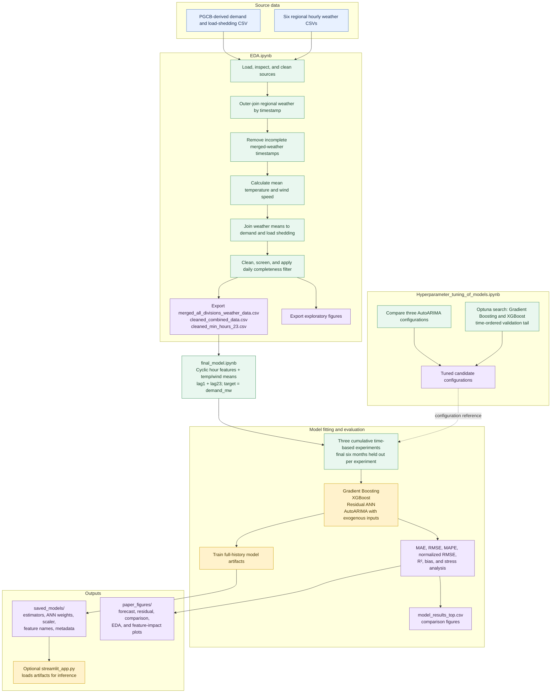

# Project workflow diagram

This diagram summarizes the implemented data preparation, tuning, evaluation,
artifact, and optional inference paths for the `7_model` project.

## Interpretation notes

- The final model uses six predictors: `hour_sin`, `hour_cos`, `temp_mean`,
  `wspd_mean`, `lag1`, and `lag23`. `load_shedding` is used for stress analysis,
  not as a model predictor.
- Lags are shifted by row, and days with 23 observations may still contain
  missing hourly timestamps. Confirm cadence before interpreting a row lag as
  a fixed elapsed-time lag.
- The three reported test periods are July-December 2023, 2024, and 2025.
- Tuning results inform candidate selection; they are not automatically the
  same as the fixed configurations used by the final notebook.
- The raw source CSVs are external to this folder, and notebook cells include
  machine-specific paths that may need updating.
